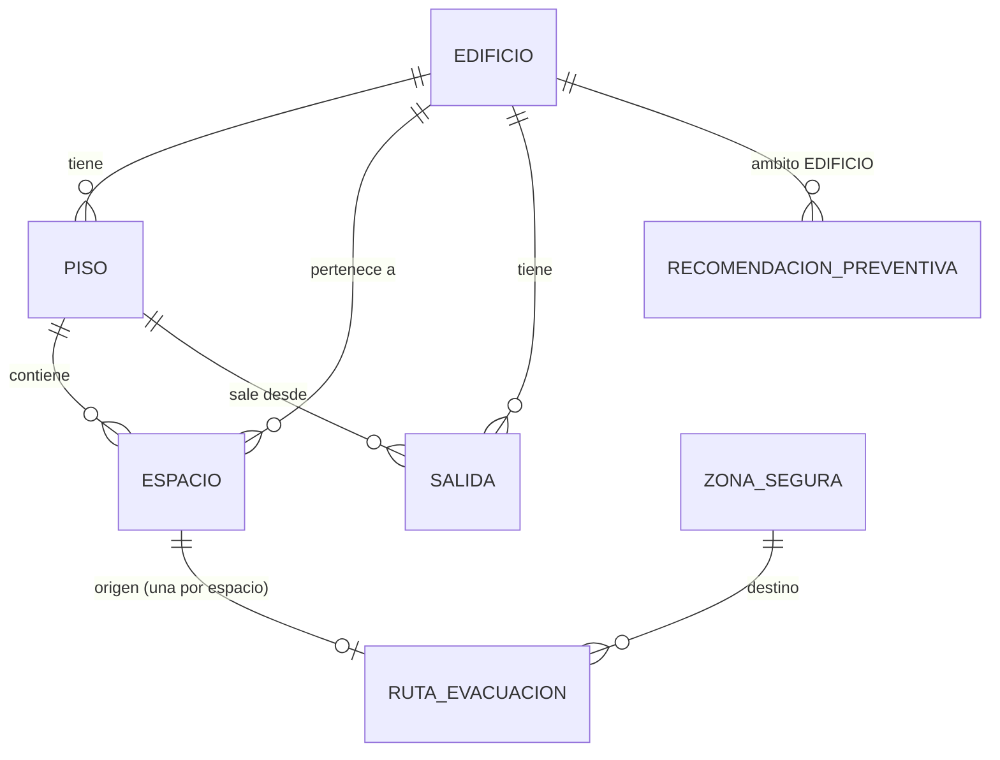
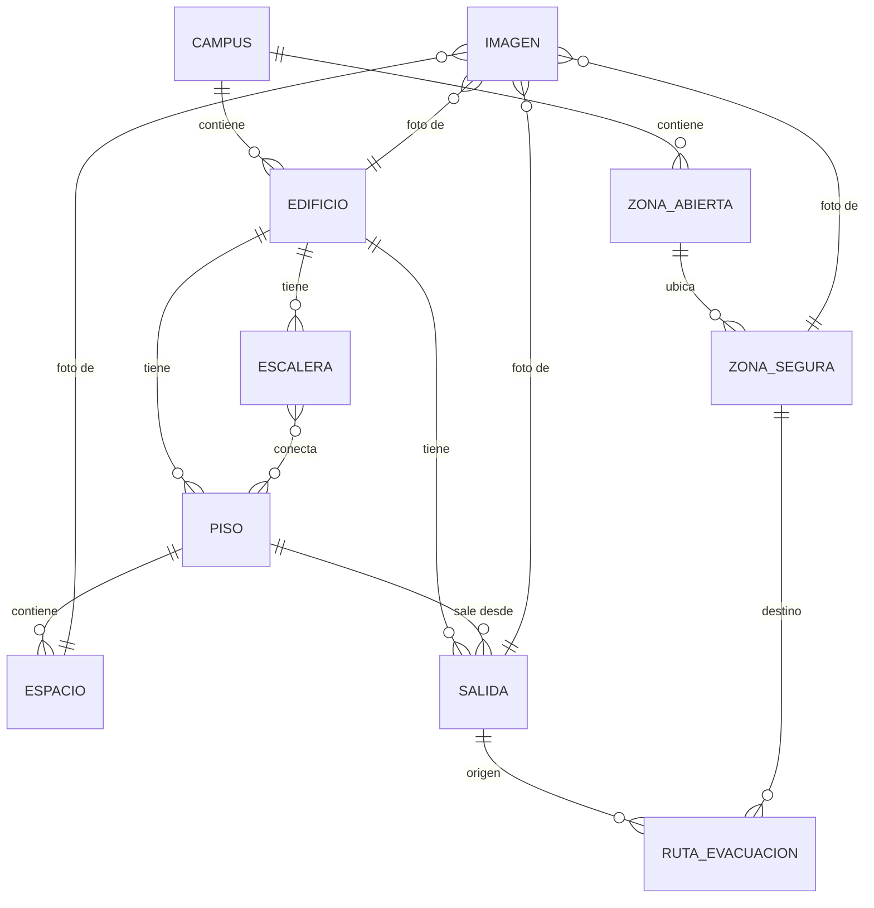

# ms02-campus-and-security
MS02 - Buildings, spaces, safe zones, meeting points, and evacuation routes service.

## Requerimientos funcionales

**RF-01 · Gestionar edificios**
El administrador podrá crear, modificar e inactivar edificios.

**RF-02 · Gestionar pisos**
El administrador podrá registrar pisos asociados a un edificio.

**RF-03 · Gestionar espacios**
El administrador podrá registrar, modificar e inactivar espacios (salones, laboratorios, auditorios, oficinas y espacios comunes) asociados a un piso de un edificio.

**RF-04 · Gestionar zonas seguras / puntos de encuentro**
El administrador podrá registrar, modificar e inactivar zonas seguras, indicando código, nombre, ubicación, descripción y capacidad aproximada.

**RF-05 · Gestionar rutas de evacuación**
El administrador podrá asociar espacios con rutas recomendadas y definir su estado (disponible, bloqueada, restringida).

**RF-06 · Consultar ruta de evacuación**
El usuario podrá consultar la ruta recomendada según el edificio o espacio seleccionado.

**RF-07 · Reactivar elementos del campus**
El administrador podrá reactivar un edificio, piso, espacio o zona segura que fue inactivado, conservando todos sus datos.

**RF-08 · Gestionar información preventiva**
El administrador podrá registrar, modificar e inactivar recomendaciones preventivas asociadas a un edificio o a un tipo de espacio, y al usuario consultarlas.

**RF-09 · Consultar catálogo del campus**
Los usuarios y otros servicios podrán consultar los edificios, pisos, espacios y zonas seguras del campus con sus identificadores y estado.

## Modelo de datos

### Estado actual (develop)



- **Edificio**: id, codigo (único), nombre, descripcion, estado (ACTIVO/INACTIVO)
- **Piso**: id, edificioId, numero (puede ser negativo para sótanos), nombre, estado. Único por (edificio, número)
- **Espacio**: id, edificioId, pisoId, codigo (único por edificio), nombre, tipo (SALON/LABORATORIO/AUDITORIO/OFICINA/ESPACIO_COMUN), estado
- **Salida**: id, edificioId, pisoId, codigo (único por edificio), nombre, latitud, longitud (obligatorias), estado
- **ZonaSegura**: id, codigo (fijo, no se puede cambiar), nombre, ubicacion, descripcion, capacidad, estado
- **RutaEvacuacion**: id, espacioOrigenId (único), zonaSeguraDestinoId, descripcion, estado (DISPONIBLE/BLOQUEADA/RESTRINGIDA), motivo (obligatorio si no está disponible)
- **RecomendacionPreventiva**: ambito (EDIFICIO o TIPO_ESPACIO), edificioId o tipoEspacio, titulo, recomendacion, estado

**Regla de dominio actual:** `Edificio`, `Espacio` y `ZonaSegura` no se eliminan (hard delete) si tienen una `RutaEvacuacion` con estado distinto de inactiva referenciándolos: solo se inactivan.

### Modelo objetivo (en construcción, ver ADR-003)



**Cómo funciona la evacuación**
1. **Dentro del edificio:** el sistema identifica edificio y piso y recomienda una escalera disponible hasta el piso de salida. No hay ruta salón → escalera ni coordenadas interiores.
2. **Fuera del edificio:** la ruta va de la salida exterior a una zona segura y se calcula con OpenStreetMap (servicio de ruteo peatonal) detrás de la abstracción `ProveedorNavegacion`.

**Reglas de dominio del modelo objetivo**
- `Edificio`, `Piso`, `Espacio`, `Escalera`, `Salida` y `ZonaSegura` no se eliminan: se inactivan.
- Una escalera bloqueada o fuera de servicio nunca se recomienda.
- Una zona segura sin coordenadas no puede ser destino de una ruta exterior.
- Solo llevan coordenadas los elementos exteriores: salidas, zonas seguras y zonas abiertas que participen en la navegación.
- No existe la entidad `PuntoEncuentro`: es una `ZonaSegura` marcada como punto de encuentro.
- Los QR se generan automáticamente a partir del UUID del elemento; la consulta pública es de solo lectura.
- MS02 no maneja asistencia ni control de evacuados (eso es de MS04).

## Salidas, códigos QR y consulta pública

Todas las rutas pasan por el API Gateway (`http://localhost:8080`). Las administrativas necesitan el token de MS01; la consulta pública no.

### Salidas

Salida física del edificio al exterior, asociada al piso desde el que se sale. Es el único elemento del edificio con coordenadas (ADR-003).

| Método | Ruta | Permiso | Qué hace |
|---|---|---|---|
| POST | `/api/v1/buildings/{edificioId}/exits` | `ms02:building:write` | Registra una salida en un piso activo del edificio |
| GET | `/api/v1/buildings/{edificioId}/exits` | `ms02:campus:read` | Lista las salidas disponibles (`?incluirInactivos=true` para todas) |
| GET | `/api/v1/exits/{id}` | `ms02:campus:read` | Consulta una salida |
| PUT | `/api/v1/exits/{id}` | `ms02:building:write` | Cambia piso, nombre y coordenadas (el código es fijo) |
| PATCH | `/api/v1/exits/{id}/deactivate` · `/reactivate` | `ms02:building:write` | Inactiva o reactiva |

```bash
curl -X POST http://localhost:8080/api/v1/buildings/{edificioId}/exits   -H "Authorization: Bearer <token>" -H "Content-Type: application/json"   -d '{"pisoId":"<pisoId>","codigo":"G-S1","nombre":"Salida principal","latitud":4.78271,"longitud":-74.04263}'
```

Reglas: el piso debe ser del mismo edificio y estar activo, las coordenadas son obligatorias y el código no se repite en el edificio (409). Una salida cuyo piso o edificio está inactivo responde `disponible: false` y no se usa como origen de rutas exteriores.

### Códigos QR

Se generan al vuelo a partir del UUID del elemento y solo contienen el enlace a la pantalla pública del frontend, que muestra la información y llama a la consulta pública (ADR-004).

| Método | Ruta | Permiso | Enlace que contiene el QR |
|---|---|---|---|
| GET | `/api/v1/spaces/{id}/qr` | `ms02:building:write` | `{QR_BASE_URL}/#/qr/espacios/{id}` |
| GET | `/api/v1/exits/{id}/qr` | `ms02:building:write` | `{QR_BASE_URL}/#/qr/salidas/{id}` |
| GET | `/api/v1/safe-zones/{id}/qr` | `ms02:safe_zone:write` | `{QR_BASE_URL}/#/qr/zonas/{id}` |

```bash
curl -o qr-salida.png http://localhost:8080/api/v1/exits/{id}/qr -H "Authorization: Bearer <token>"
```

`QR_BASE_URL` (en `.env`) debe ser la dirección pública definitiva del frontend antes de imprimir los QR: si cambia, los QR impresos dejan de funcionar.

### Consulta pública (sin sesión)

La usa la pantalla pública del front que abre el QR. Solo GET y solo datos mínimos, sin ids internos.

```bash
curl "http://localhost:8080/api/v1/public/spaces?id={id}"
```

```json
{
  "codigo": "G-201", "nombre": "Salón 201", "tipo": "SALON",
  "edificio": "Bloque G", "piso": 2, "disponible": true,
  "evacuacion": {
    "tieneRuta": true, "zonaSegura": "Plazoleta H", "ubicacionZonaSegura": "Frente al bloque H",
    "recorrido": "Baje por la escalera norte y salga por la puerta principal.",
    "estado": "DISPONIBLE", "motivo": null, "mensaje": null, "recomendaciones": []
  },
  "aviso": null
}
```

`/api/v1/public/exits?id=` devuelve nombre, edificio, piso y coordenadas; `/api/v1/public/safe-zones?id=` devuelve ubicación, coordenadas y si es punto de encuentro. Si el elemento está inactivo responde `disponible: false` con un aviso; si no existe, `404 NO_ENCONTRADO`. Más detalle en [docs/consulta-publica-qr.md](docs/consulta-publica-qr.md).

## Contratos API
https://editor.swagger.io/