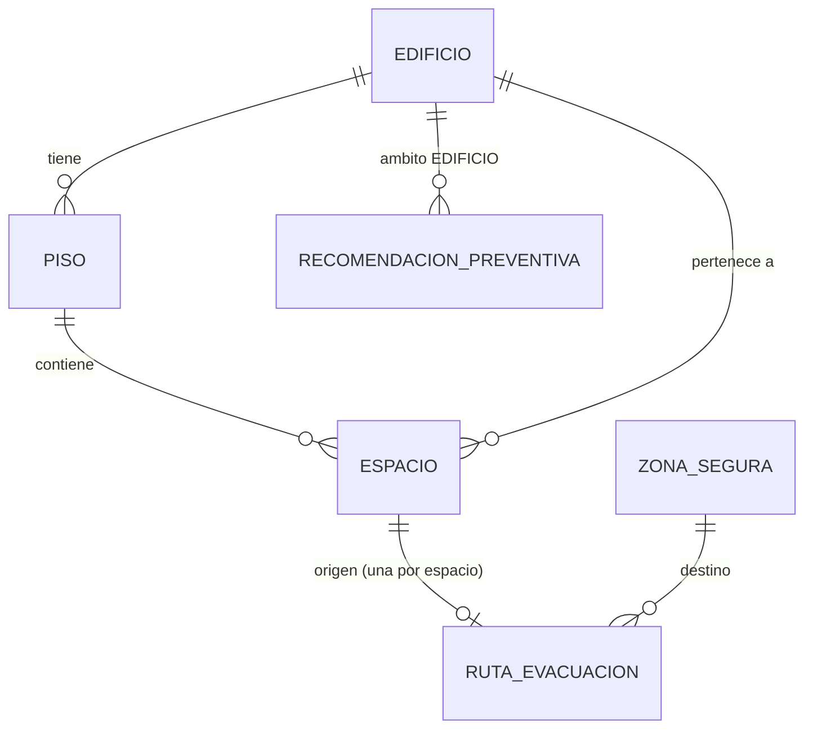
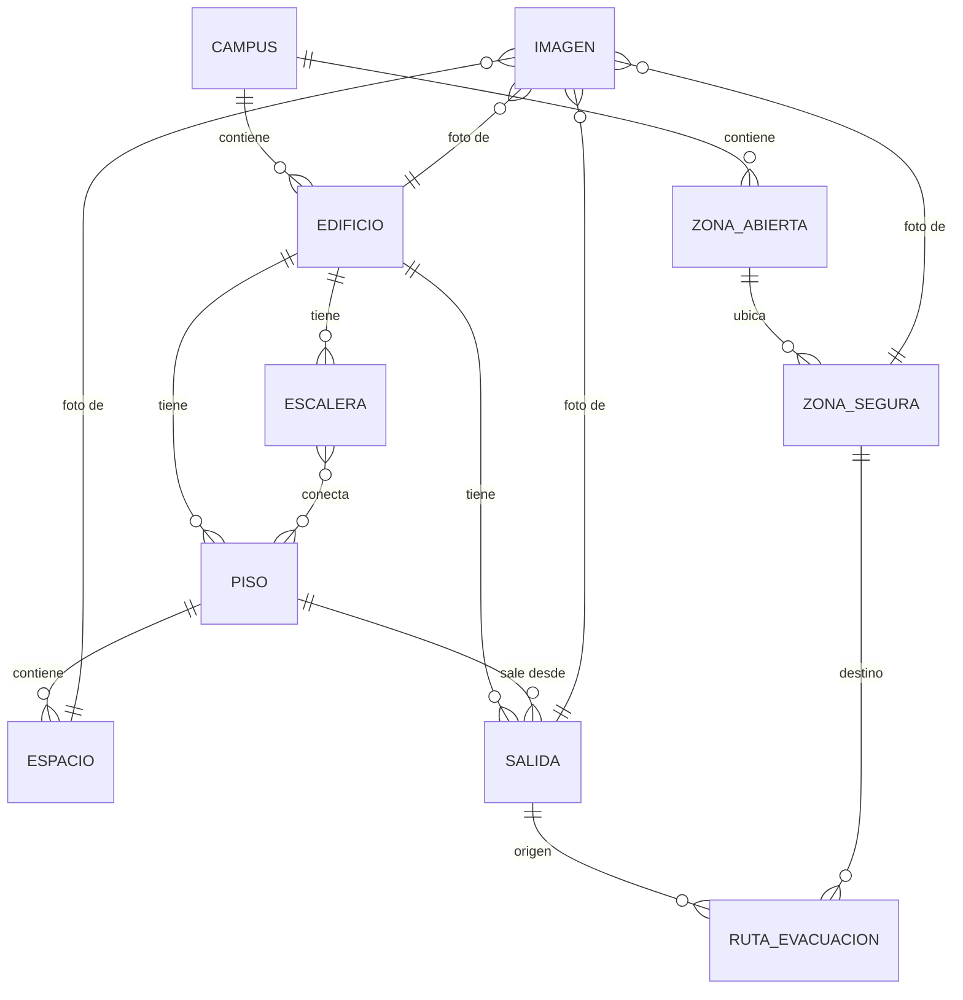

# ms02-campus-and-security
MS02 - Buildings, spaces, safe zones, meeting points, and evacuation routes service.

## Requerimientos funcionales

**RF-01 · Gestionar edificios**
El administrador podrá crear, modificar e inactivar edificios.

**RF-02 · Gestionar pisos**
El administrador podrá registrar pisos asociados a un edificio.

**RF-03 · Gestionar espacios**
El administrador podrá registrar, modificar e inactivar espacios (salones, laboratorios, auditorios, oficinas y espacios comunes) asociados a un piso de un edificio.

**RF-04 · Gestionar zonas seguras / puntos de encuentro**
El administrador podrá registrar, modificar e inactivar zonas seguras, indicando código, nombre, ubicación, descripción y capacidad aproximada.

**RF-05 · Gestionar rutas de evacuación**
El administrador podrá asociar espacios con rutas recomendadas y definir su estado (disponible, bloqueada, restringida).

**RF-06 · Consultar ruta de evacuación**
El usuario podrá consultar la ruta recomendada según el edificio o espacio seleccionado.

**RF-07 · Reactivar elementos del campus**
El administrador podrá reactivar un edificio, piso, espacio o zona segura que fue inactivado, conservando todos sus datos.

**RF-08 · Gestionar información preventiva**
El administrador podrá registrar, modificar e inactivar recomendaciones preventivas asociadas a un edificio o a un tipo de espacio, y al usuario consultarlas.

**RF-09 · Consultar catálogo del campus**
Los usuarios y otros servicios podrán consultar los edificios, pisos, espacios y zonas seguras del campus con sus identificadores y estado.

## Modelo de datos

### Estado actual (develop)

- **Edificio**: id, codigo (único), nombre, descripcion, estado (ACTIVO/INACTIVO)
- **Piso**: id, edificioId, numero (puede ser negativo para sótanos), nombre, estado. Único por (edificio, número)
- **Espacio**: id, edificioId, pisoId, codigo (único por edificio), nombre, tipo (SALON/LABORATORIO/AUDITORIO/OFICINA/ESPACIO_COMUN), estado
- **ZonaSegura**: id, codigo (fijo, no se puede cambiar), nombre, ubicacion, descripcion, capacidad, estado
- **RutaEvacuacion**: id, espacioOrigenId (único), zonaSeguraDestinoId, descripcion, estado (DISPONIBLE/BLOQUEADA/RESTRINGIDA), motivo (obligatorio si no está disponible)
- **RecomendacionPreventiva**: ambito (EDIFICIO o TIPO_ESPACIO), edificioId o tipoEspacio, titulo, recomendacion, estado

**Regla de dominio actual:** `Edificio`, `Espacio` y `ZonaSegura` no se eliminan (hard delete) si tienen una `RutaEvacuacion` con estado distinto de inactiva referenciándolos: solo se inactivan.

### Modelo objetivo (en construcción, ver ADR-003)

**Cómo funciona la evacuación**
1. **Dentro del edificio:** el sistema identifica edificio y piso y recomienda una escalera disponible hasta el piso de salida. No hay ruta salón → escalera ni coordenadas interiores.
2. **Fuera del edificio:** la ruta va de la salida exterior a una zona segura y se calcula con OpenStreetMap (servicio de ruteo peatonal) detrás de la abstracción `ProveedorNavegacion`.

**Reglas de dominio del modelo objetivo**
- `Edificio`, `Piso`, `Espacio`, `Escalera`, `Salida` y `ZonaSegura` no se eliminan: se inactivan.
- Una escalera bloqueada o fuera de servicio nunca se recomienda.
- Una zona segura sin coordenadas no puede ser destino de una ruta exterior.
- Solo llevan coordenadas los elementos exteriores: salidas, zonas seguras y zonas abiertas que participen en la navegación.
- No existe la entidad `PuntoEncuentro`: es una `ZonaSegura` marcada como punto de encuentro.
- Los QR se generan automáticamente a partir del UUID del elemento; la consulta pública es de solo lectura.
- MS02 no maneja asistencia ni control de evacuados (eso es de MS04).

## Contratos API
https://editor.swagger.io/