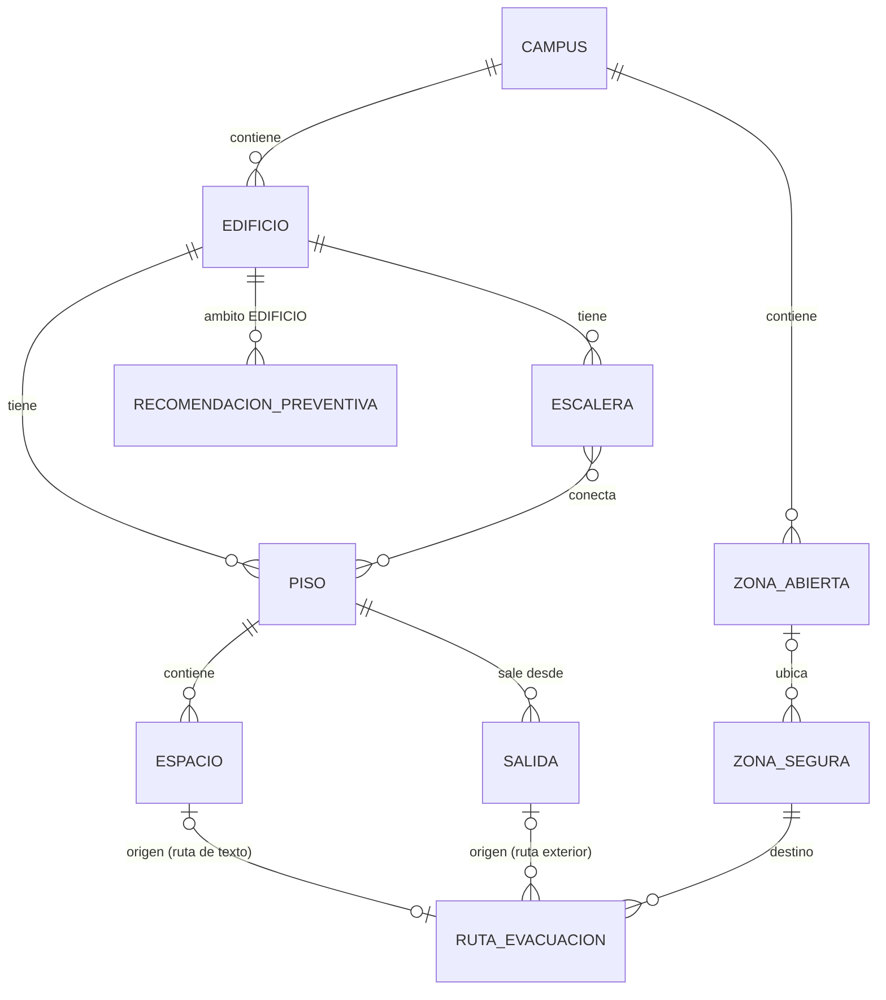

# ms02-campus-and-security
MS02 - Buildings, spaces, safe zones, meeting points, and evacuation routes service.

## Documentación

Los requerimientos, formularios, modelo de datos, contrato y diagramas de MS02 están en el repositorio
[documentation](https://github.com/CampusSeguro-DOSW-2026-2/documentation/blob/develop/ms02-campus-and-security):

| Documento | Contenido |
|---|---|
| [`1_requirements.md`](https://github.com/CampusSeguro-DOSW-2026-2/documentation/blob/develop/ms02-campus-and-security/1_requirements.md) | RF-MS02-01 a 16, reglas de negocio, RNF y tabla de endpoints con permisos |
| [`2_forms-inputs.md`](https://github.com/CampusSeguro-DOSW-2026-2/documentation/blob/develop/ms02-campus-and-security/2_forms-inputs.md) | Campos, validaciones y mensajes de cada formulario |
| [`3_modelo-datos.md`](https://github.com/CampusSeguro-DOSW-2026-2/documentation/blob/develop/ms02-campus-and-security/3_modelo-datos.md) | Tablas, restricciones y migraciones |
| [`api/swagger.yml`](https://github.com/CampusSeguro-DOSW-2026-2/documentation/blob/develop/ms02-campus-and-security/api/swagger.yml) | Contrato OpenAPI (el mismo que expone `/v3/api-docs`) |
| [`diagramas/`](https://github.com/CampusSeguro-DOSW-2026-2/documentation/blob/develop/ms02-campus-and-security/diagramas) | Componentes, clases, modelo de datos físico y despliegue |

Las decisiones de diseño están en [`docs/adr`](docs/adr).

## Modelo de datos



Las imágenes se asocian a edificios, espacios, salidas y zonas seguras por tipo e id. El detalle de cada tabla está en
[`3_modelo-datos.md`](https://github.com/CampusSeguro-DOSW-2026-2/documentation/blob/develop/ms02-campus-and-security/3_modelo-datos.md).

**Cómo funciona la evacuación**
1. **Dentro del edificio:** el sistema identifica edificio y piso y recomienda escaleras disponibles hasta el piso de una salida. No hay ruta salón → escalera ni coordenadas interiores.
2. **Fuera del edificio:** la ruta va de la salida a una zona segura y se calcula con OpenStreetMap (ruteo peatonal) detrás de la interfaz `ProveedorNavegacion`. Ver [docs/navegacion-exterior.md](docs/navegacion-exterior.md).

**Reglas de dominio**
- Nada se elimina, solo se inactiva (salvo las imágenes).
- Edificios, espacios y salidas se identifican solo por su UUID. Las zonas seguras tienen un código fijo y las escaleras uno generado.
- Todo edificio pertenece a un campus.
- Una escalera bloqueada, fuera de servicio o inactiva nunca se recomienda.
- Una zona segura sin coordenadas no puede ser destino de una ruta exterior.
- Solo llevan coordenadas los elementos exteriores: salidas, zonas seguras y zonas abiertas.
- No existe la entidad `PuntoEncuentro`: es una `ZonaSegura` marcada como punto de encuentro.
- MS02 no maneja asistencia ni control de evacuados (eso es de MS04).

## Salidas, códigos QR y consulta pública

Todas las rutas pasan por el API Gateway (`http://localhost:8080`). Las administrativas necesitan el token de MS01; la consulta pública no.

### Salidas

Salida física del edificio al exterior, asociada al piso desde el que se sale. Es el único elemento del edificio con coordenadas (ADR-003).

| Método | Ruta | Permiso | Qué hace |
|---|---|---|---|
| POST | `/api/v1/buildings/{edificioId}/exits` | `ms02:building:write` | Registra una salida en un piso activo del edificio |
| GET | `/api/v1/buildings/{edificioId}/exits` | `ms02:campus:read` | Lista las salidas disponibles (`?incluirInactivos=true` para todas) |
| GET | `/api/v1/exits/{id}` | `ms02:campus:read` | Consulta una salida |
| PUT | `/api/v1/exits/{id}` | `ms02:building:write` | Cambia piso, nombre y coordenadas |
| PATCH | `/api/v1/exits/{id}/deactivate` · `/reactivate` | `ms02:building:write` | Inactiva o reactiva |

```bash
curl -X POST http://localhost:8080/api/v1/buildings/{edificioId}/exits   -H "Authorization: Bearer <token>" -H "Content-Type: application/json"   -d '{"pisoId":"<pisoId>","nombre":"Salida principal","latitud":4.78271,"longitud":-74.04263}'
```

Reglas: el piso debe ser del mismo edificio y estar activo y las coordenadas son obligatorias. Una salida cuyo piso o edificio está inactivo responde `disponible: false` y no se usa como origen de rutas exteriores.

### Códigos QR

Se generan al vuelo a partir del UUID del elemento y solo contienen el enlace a la pantalla pública del frontend, que muestra la información y llama a la consulta pública (ADR-004).

| Método | Ruta | Permiso | Enlace que contiene el QR |
|---|---|---|---|
| GET | `/api/v1/spaces/{id}/qr` | `ms02:qr:manage` | `{QR_BASE_URL}/#/qr/espacios/{id}` |
| GET | `/api/v1/exits/{id}/qr` | `ms02:qr:manage` | `{QR_BASE_URL}/#/qr/salidas/{id}` |
| GET | `/api/v1/safe-zones/{id}/qr` | `ms02:qr:manage` | `{QR_BASE_URL}/#/qr/zonas/{id}` |

```bash
curl -o qr-salida.png http://localhost:8080/api/v1/exits/{id}/qr -H "Authorization: Bearer <token>"
```

`QR_BASE_URL` (en `.env`) debe ser la dirección pública definitiva del frontend antes de imprimir los QR: si cambia, los QR impresos dejan de funcionar.

### Consulta pública (sin sesión)

La usa la pantalla pública del front que abre el QR. Solo GET y solo datos mínimos, sin ids internos.

```bash
curl "http://localhost:8080/api/v1/public/spaces?id={id}"
```

```json
{
  "nombre": "Salón 201", "tipo": "SALON",
  "edificio": "Bloque G", "piso": 2, "disponible": true,
  "evacuacion": {
    "tieneRuta": true, "zonaSegura": "Plazoleta H", "ubicacionZonaSegura": "Frente al bloque H",
    "recorrido": "Baje por la escalera norte y salga por la puerta principal.",
    "estado": "DISPONIBLE", "motivo": null, "mensaje": null, "recomendaciones": []
  },
  "aviso": null
}
```

`/api/v1/public/exits?id=` devuelve nombre, edificio, piso y coordenadas; `/api/v1/public/safe-zones?id=` devuelve ubicación, coordenadas y si es punto de encuentro. Si el elemento está inactivo responde `disponible: false` con un aviso; si no existe, `404 NO_ENCONTRADO`. Más detalle en [docs/consulta-publica-qr.md](docs/consulta-publica-qr.md).

## Despliegue en la nube

MS02 se despliega en Azure detrás del API Gateway, con un runner self-hosted y la imagen publicada en GHCR por el CI. El
paso a paso está en [docs/despliegue-azure.md](docs/despliegue-azure.md).

## Contrato API

Con el servicio en marcha, el contrato está en `http://localhost:8082/v3/api-docs` (Swagger UI en
`/swagger-ui.html`). La copia publicada para el Gateway y los demás squads es
[`api/swagger.yml`](https://github.com/CampusSeguro-DOSW-2026-2/documentation/blob/develop/ms02-campus-and-security/api/swagger.yml); se actualiza exportando `/v3/api-docs.yaml` cada vez que cambia un
endpoint o un permiso.